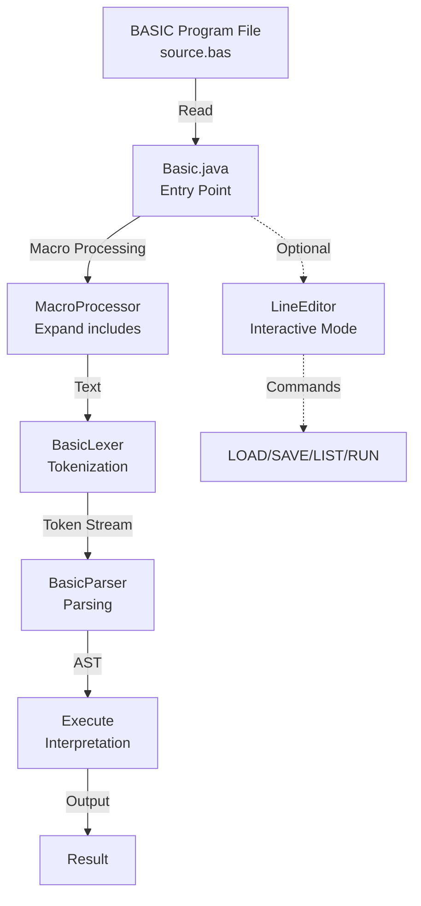

# GD-BASIC: System Architecture

**Understanding the design and structure of the BASIC interpreter.**

---

## 🏗️ High-Level Architecture



---

## 🔄 Execution Pipeline

### Stage 1: Macro Processing
```
Input:  "INCLUDE 'lib.bas'"
        BASIC program text
        
Process: Replace macro directives
         Expand included files
         
Output: Expanded BASIC text (no macros)
```

### Stage 2: Tokenization (Lexical Analysis)
```
Input:  "10 PRINT X + 5"

Process: Identify tokens:
         NUMBER(10), PRINT, IDENTIFIER(X), PLUS, NUMBER(5)
         
Output: List<Token> with types
```

### Stage 3: Parsing (Syntax Analysis)
```
Input:  Token stream
        [NUMBER(10), PRINT, IDENTIFIER(X), PLUS, NUMBER(5)]
        
Process: Build Abstract Syntax Tree
         Validate syntax
         Create statement objects
         
Output: Statement AST
        PRINT statement with expression: X + 5
```

### Stage 4: Execution (Runtime)
```
Input:  Statement AST
        Program state (variables, program pointer)
        
Process: Execute each statement
         Update variables
         Handle flow control (GOTO, GOSUB)
         Manage call stack
         
Output: Program output
        Final variable state
        Exit code
```

---

## 📦 Core Components

### 1. BasicLexer (Tokenization)

**Location**: `tokenizer/BasicLexer.java`

```
Responsibility: Convert text → tokens
Input:  String (program line)
Output: List<Token>

Example:
  Input:  "10 LET X = 5 + 3"
  Output: [NUMBER(10), LET, IDENTIFIER(X), EQUALS, 
           NUMBER(5), PLUS, NUMBER(3)]
```

**Token Types**: 100+ types including:
- Literals: NUMBER, STRING
- Keywords: LET, IF, FOR, PRINT, INPUT
- Operators: PLUS, MINUS, MULTIPLY, DIVIDE
- Functions: SIN, COS, LEN, INT
- Types: REAL%, INTEGER%, STRING$

---

### 2. BasicParser (Syntax Analysis)

**Location**: `parser/BasicParser.java`

```
Responsibility: Parse tokens → create statement objects
Input:  List<Token> + execution context
Output: Statement object

Example:
  Input:  Token stream for "IF X > 5 THEN PRINT X"
  Output: If statement object with:
          - condition: X > 5
          - thenBlock: PRINT X
```

**Parser Type**: Recursive descent
- Implements grammar rules recursively
- One method per grammar rule
- Handles operator precedence
- Supports both Dartmouth and standard evaluation

---

### 3. Execute (Runtime Engine)

**Location**: `runtimeManager/Execute.java`

```
Responsibility: Execute statement objects
Input:  Statement, execution context
Output: Program output, state changes

Operations:
  - Execute statements
  - Manage variables
  - Handle jumps (GOTO, GOSUB)
  - Manage stack (CALL/RETURN)
  - Control flow
```

---

### 4. Statement Classes (35+)

**Location**: `statements/`

```
Structure: extends Statement interface
Each statement implements:
  - execute(ExecutionContext)
  - Validation logic
  - Error handling

Examples:
  - If.java      → IF...THEN...ELSE
  - For.java     → FOR...NEXT loops
  - Print.java   → PRINT statements
  - Input.java   → INPUT statements
  - Gosub.java   → GOSUB...RETURN
  - GoTo.java    → GOTO jumps
  - ...and 29 more
```

---

### 5. Function Classes (40+)

**Location**: `functions/`

```
Structure: extends Function interface
Each function implements:
  - evaluate(parameters)
  - Type checking
  - Return value

Categories:
  Math:    SIN, COS, TAN, LOG, EXP, ABS, INT, RND, ...
  String:  LEN, MID$, LEFT$, RIGHT$, UPPER$, LOWER$, ...
  I/O:     PRINT (redirected), INPUT
  System:  RND, TIME, CHR$, ASC, STR$, VAL, ...
  File:    OPEN, CLOSE, READ, WRITE
```

---

### 6. Type System

**Location**: `variableTypes/`

```
Type Hierarchy:
  Value (interface)
    ├─ RealValue      (default, double precision; no suffix)
    ├─ IntegerValue   (% suffix, 32-bit)
    ├─ LongValue      (& suffix, 64-bit)
    ├─ StringValue    ($ suffix, text)
    ├─ BooleanValue   (! suffix in 0.3.0; @ suffix in 0.2.x)
    └─ BcdValue       (# suffix, decimal, up to 40 significant digits; implemented in 0.3.0)

Variable Naming (released 0.2.1; version 0.3.0 differs, see below):
  X      → Real
  I%     → Integer
  L&     → Long
  S$     → String
  D!     → Double (VariableManagement.java maps `!` to VariableType.DOUBLE)
  B@     → Boolean

Variable Naming (version 0.3.0, branch feature/bcd-arithmetic):
  X      → Real
  A#     → Decimal (BCD)
  F!     → Boolean
  B@     → error (use `!`)
```

**Note**: v0.2.0 removed the `#` suffix. Version 0.3.0 on branch `feature/bcd-arithmetic` uses `#` for BCD, keeps untyped variables as REAL, and makes `!` BOOLEAN. The authoritative status table is in `doc/BASIC.md`.

---

### 7. Memory Management

**Location**: `memoryManager/`

```
Program State:
  ├─ Variables       (VariableManagement)
  │  └─ Map<String, Value>
  ├─ Program         (source text + parsed statements)
  ├─ Stack           (for CALL/RETURN)
  ├─ ProgramPointer  (current line being executed)
  └─ Labels/GoSub    (jump targets)

Flow Control:
  - ProgramPointer tracks position
  - GOTO: sets ProgramPointer to target line
  - GOSUB: pushes return address to stack
  - RETURN: pops from stack
  - FOR/NEXT: maintains loop state
```

---

### 8. Line Editor (v0.2.0+)

**Location**: `lineEditor/LineEditor.java`

```
NEW in v0.2.0+: Interactive mode

Commands:
  LIST    → Display program
  RUN     → Execute (requires content)
  LOAD    → Load from file
  SAVE    → Save to file
  DELETE  → Delete line
  NEW     → Clear program
  HELP    → Show help
  QUIT    → Exit

Features:
  - Line-by-line editing
  - Load/Save .bas files
  - Inline editing
  - Line numbering (10, 20, 30...)
```

---

## 🌳 Class Hierarchy

```
Statement Interface
├─ If.java
├─ For.java
├─ Print.java
├─ Input.java
├─ Gosub.java
├─ GoTo.java
└─ ...29 more

Function Interface
├─ Sin.java
├─ Cos.java
├─ Len.java
├─ RND.java
└─ ...36 more

Value Interface
├─ RealValue
├─ IntegerValue
├─ StringValue
└─ ...
```

---

## 🔀 Control Flow

### Program Execution Loop

```
1. Load program (file or interactive)
2. Macro processing
3. Tokenize each line
4. Parse each line → create Statement
5. Store statements indexed by line number

6. Set ProgramPointer to first line
7. Loop:
   a. Get current statement
   b. Execute statement
   c. Move to next line (or GOTO target)
   d. Check for END or errors
   e. Continue if more statements

8. Print output
9. Return to editor (or exit)
```

---

## 🎯 Evaluation Modes

### Dartmouth Mode (`-d` flag)

```
Expression: 2 + 3 * 4
Evaluation: Left-to-right (legacy Dartmouth)
Result:    (2 + 3) * 4 = 20
```

### Standard Mode (default)

```
Expression: 2 + 3 * 4
Evaluation: PEMDAS/BODMAS (standard)
Result:    2 + (3 * 4) = 14
```

**Toggle**: `BasicParser._bDartmouthFlag` or `-d` command line flag

---

## 📊 Data Flow Example

### Processing: "10 PRINT X + 5"

```
Input: "10 PRINT X + 5"

1. TOKENIZATION
   Input:  "10 PRINT X + 5"
   Tokens: [NUMBER(10), KEYWORD(PRINT), 
            IDENTIFIER(X), OPERATOR(+), NUMBER(5)]

2. PARSING
   Input:  Token stream
   AST:    Print {
             expressions: [
               BinaryOp(PLUS,
                 Variable(X),
                 Literal(5)
               )
             ]
           }

3. EXECUTION
   Input:  Print statement + variables {X=3}
   Action: Evaluate X + 5 → 8
           Print "8"
           Move to next line
   Output: "8" (printed)
```

---

## 🔌 Extension Points

### Adding a Statement

```
1. Create: statements/NewStatement.java
2. Extend: Statement interface
3. Parse:  Add parsing logic to BasicParser
4. Execute: Implement execute() method
5. Test:   Create test case
6. Done!   Integrated into pipeline
```

### Adding a Function

```
1. Create: functions/NewFunction.java
2. Extend: Function interface
3. Evaluate: Implement evaluate() method
4. Register: Add to function registry
5. Test:   Create test case
6. Done!   Available as built-in
```

---

## ✅ Quality Assurance

### Test Coverage

```
Total Tests:       1435
Passing:          1435 (100%)
Failing:          0

Test Categories:
  - Tokenizer tests (50+)
  - Parser tests (100+)
  - Statement tests (300+)
  - Function tests (200+)
  - Integration tests (500+)
  - Edge case tests (98+)
```

---

## 🎯 Key Design Patterns

| Pattern | Use Case |
|---------|----------|
| **Visitor** | Execute statements |
| **Strategy** | Different evaluation modes |
| **Factory** | Create values of different types |
| **Singleton** | Logger, FileHandler |
| **Stack** | CALL/RETURN management |
| **State Machine** | Parser state transitions |

---

## 🔒 Error Handling

```
Exception Hierarchy:
RuntimeException (java.lang)
  ├─ BasicException (base)
  ├─ SyntaxErrorException
  ├─ RuntimeErrorException
  ├─ DivideByZeroException
  ├─ EmptyProgramException
  ├─ EmptyStackException
  ├─ EndOfProgramException
  └─ ...
```

---

## 🚀 Performance Considerations

```
Optimization techniques:
  - Token caching (avoid re-tokenizing)
  - Statement objects created once
  - Variable lookup via HashMap
  - Expression evaluation (single pass)
  - Stack-based function calls

Benchmarks:
  - Small programs: <50ms
  - Medium programs: <200ms
  - Large programs: <1s
  - 1435 tests run: ~5s
```

---

## 📈 Version Evolution

```
0.1.0: Initial BASIC interpreter
0.2.0: Added line editor, fixed types
0.2.1: Production ready (1248 tests passing)
0.3.0: Implemented on branch feature/bcd-arithmetic (not yet merged): decimal (BCD) type with `#` suffix
       See doc/BASIC.md
```

---

This architecture enables a full-featured BASIC interpreter in ~15,000 lines of well-organized, testable Java code.

