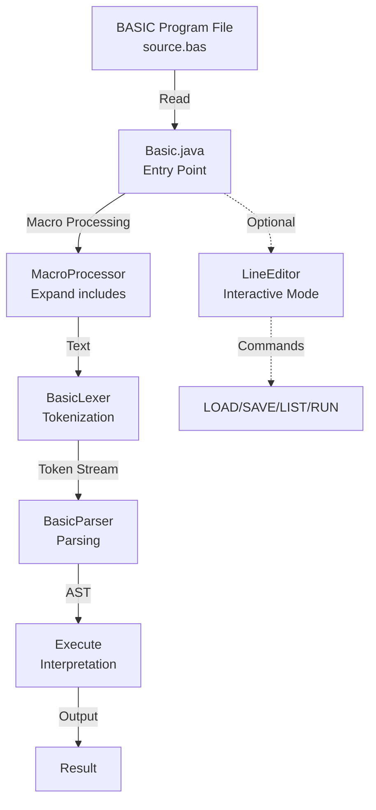
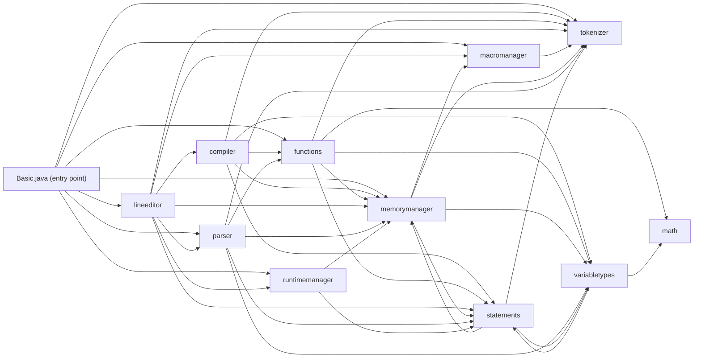
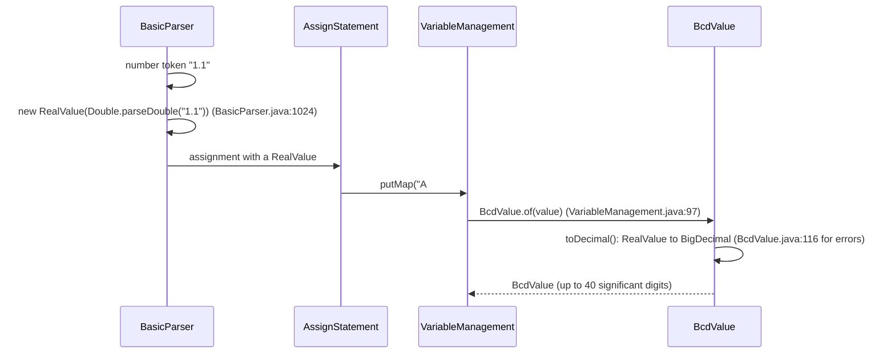
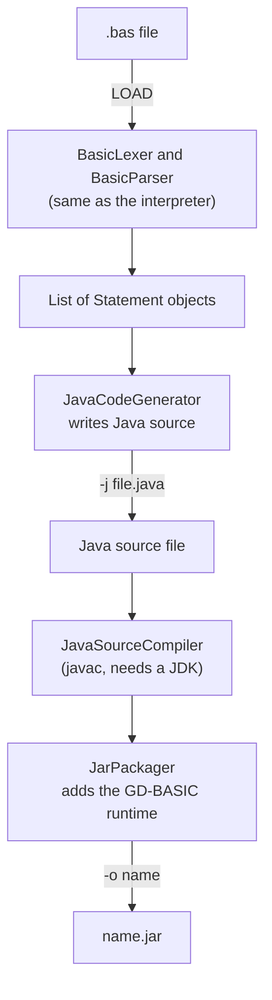

# GD-BASIC: System Architecture

**Understanding the design and structure of the BASIC interpreter.**

---

## 🏗️ High-Level Architecture



---

## 🔄 Execution Pipeline

### Stage 1: Macro Processing
```
Input:  "INCLUDE 'lib.bas'"
        BASIC program text
        
Process: Replace macro directives
         Expand included files
         
Output: Expanded BASIC text (no macros)
```

### Stage 2: Tokenization (Lexical Analysis)
```
Input:  "10 PRINT X + 5"

Process: Identify tokens:
         NUMBER(10), PRINT, IDENTIFIER(X), PLUS, NUMBER(5)
         
Output: List<Token> with types
```

### Stage 3: Parsing (Syntax Analysis)
```
Input:  Token stream
        [NUMBER(10), PRINT, IDENTIFIER(X), PLUS, NUMBER(5)]
        
Process: Build Abstract Syntax Tree
         Validate syntax
         Create statement objects
         
Output: Statement AST
        PRINT statement with expression: X + 5
```

### Stage 4: Execution (Runtime)
```
Input:  Statement AST
        Program state (variables, program pointer)
        
Process: Execute each statement
         Update variables
         Handle flow control (GOTO, GOSUB)
         Manage call stack
         
Output: Program output
        Final variable state
        Exit code
```

---

## 📦 Core Components

### 1. BasicLexer (Tokenization)

**Location**: `tokenizer/BasicLexer.java`

```
Responsibility: Convert text → tokens
Input:  String (program line)
Output: List<Token>

Example:
  Input:  "10 LET X = 5 + 3"
  Output: [NUMBER(10), LET, IDENTIFIER(X), EQUALS, 
           NUMBER(5), PLUS, NUMBER(3)]
```

**Token Types**: 100+ types including:
- Literals: NUMBER, STRING
- Keywords: LET, IF, FOR, PRINT, INPUT
- Operators: PLUS, MINUS, MULTIPLY, DIVIDE
- Functions: SIN, COS, LEN, INT
- Types: REAL%, INTEGER%, STRING$

---

### 2. BasicParser (Syntax Analysis)

**Location**: `parser/BasicParser.java`

```
Responsibility: Parse tokens → create statement objects
Input:  List<Token> + execution context
Output: Statement object

Example:
  Input:  Token stream for "IF X > 5 THEN PRINT X"
  Output: If statement object with:
          - condition: X > 5
          - thenBlock: PRINT X
```

**Parser Type**: Recursive descent
- Implements grammar rules recursively
- One method per grammar rule
- Handles operator precedence
- Supports both Dartmouth and standard evaluation

---

### 3. Execute (Runtime Engine)

**Location**: `runtimemanager/Execute.java`

```
Responsibility: Execute statement objects
Input:  Statement, execution context
Output: Program output, state changes

Operations:
  - Execute statements
  - Manage variables
  - Handle jumps (GOTO, GOSUB)
  - Manage stack (CALL/RETURN)
  - Control flow
```

---

### 4. Statement Classes (40 classes in `statements/`, checked 2026-11-23)

**Location**: `statements/`

```
Structure: extends Statement interface
Each statement implements:
  - execute(ExecutionContext)
  - Validation logic
  - Error handling

Examples:
  - If.java      → IF...THEN...ELSE
  - For.java     → FOR...NEXT loops
  - Print.java   → PRINT statements
  - Input.java   → INPUT statements
  - Gosub.java   → GOSUB...RETURN
  - GoTo.java    → GOTO jumps
  - ...and 29 more
```

---

### 5. Function Classes (39 classes in `functions/`, checked 2026-11-23)

**Location**: `functions/`

```
Structure: extends Function interface
Each function implements:
  - evaluate(parameters)
  - Type checking
  - Return value

Categories:
  Math:    SIN, COS, TAN, LOG, EXP, ABS, INT, RND, ...
  String:  LEN, MID$, LEFT$, RIGHT$, UPPER$, LOWER$, ...
  I/O:     PRINT (redirected), INPUT
  System:  RND, TIME, CHR$, ASC, STR$, VAL, ...
  File:    OPEN, CLOSE, READ, WRITE
```

---

### 6. Type System

**Location**: `variabletypes/`

```
Type Hierarchy:
  Value (interface)
    ├─ RealValue      (default, double precision; no suffix)
    ├─ IntegerValue   (% suffix, 32-bit)
    ├─ LongValue      (& suffix, 64-bit)
    ├─ StringValue    ($ suffix, text)
    ├─ BooleanValue   (! suffix in 0.4.0; @ suffix in 0.2.x)
    └─ BcdValue       (# suffix, decimal, up to 40 significant digits; implemented in 0.4.0)

Variable Naming (released 0.2.1; version 0.4.0 differs, see below):
  X      → Real
  I%     → Integer
  L&     → Long
  S$     → String
  D!     → Double (VariableManagement.java maps `!` to VariableType.DOUBLE)
  B@     → Boolean

Variable Naming (version 0.4.0, branch feature/bcd-arithmetic):
  X      → Real
  A#     → Decimal (BCD)
  F!     → Boolean
  B@     → error (use `!`)
```

**Note**: v0.2.0 removed the `#` suffix. Version 0.4.0 on branch `feature/bcd-arithmetic` uses `#` for BCD, keeps untyped variables as REAL, and makes `!` BOOLEAN. The authoritative status table is in `doc/BASIC.md`.

---

### 7. Memory Management

**Location**: `memorymanager/`

```
Program State:
  ├─ Variables       (VariableManagement)
  │  └─ Map<String, Value>
  ├─ Program         (source text + parsed statements)
  ├─ Stack           (for CALL/RETURN)
  ├─ ProgramPointer  (current line being executed)
  └─ Labels/GoSub    (jump targets)

Flow Control:
  - ProgramPointer tracks position
  - GOTO: sets ProgramPointer to target line
  - GOSUB: pushes return address to stack
  - RETURN: pops from stack
  - FOR/NEXT: maintains loop state
```

---

### 8. Line Editor (v0.2.0+)

**Location**: `lineeditor/LineEditor.java`

```
NEW in v0.2.0+: Interactive mode

Commands:
  LIST    → Display program
  RUN     → Execute (requires content)
  LOAD    → Load from file
  SAVE    → Save to file
  DELETE  → Delete line
  NEW     → Clear program
  HELP    → Show help
  QUIT    → Exit

Features:
  - Line-by-line editing
  - Load/Save .bas files
  - Inline editing
  - Line numbering (10, 20, 30...)
```

---

## 🌳 Class Hierarchy

```
Statement Interface
├─ If.java
├─ For.java
├─ Print.java
├─ Input.java
├─ Gosub.java
├─ GoTo.java
└─ ...29 more

Function Interface
├─ Sin.java
├─ Cos.java
├─ Len.java
├─ RND.java
└─ ...36 more

Value Interface
├─ RealValue
├─ IntegerValue
├─ StringValue
└─ ...
```

---

## 🔀 Control Flow

### Program Execution Loop

```
1. Load program (file or interactive)
2. Macro processing
3. Tokenize each line
4. Parse each line → create Statement
5. Store statements indexed by line number

6. Set ProgramPointer to first line
7. Loop:
   a. Get current statement
   b. Execute statement
   c. Move to next line (or GOTO target)
   d. Check for END or errors
   e. Continue if more statements

8. Print output
9. Return to editor (or exit)
```

---

## 🎯 Evaluation Modes

### Dartmouth Mode (`-d` flag)

```
Expression: 2 + 3 * 4
Evaluation: Left-to-right (legacy Dartmouth)
Result:    (2 + 3) * 4 = 20
```

### Standard Mode (default)

```
Expression: 2 + 3 * 4
Evaluation: PEMDAS/BODMAS (standard)
Result:    2 + (3 * 4) = 14
```

**Toggle**: `BasicParser._bDartmouthFlag` or `-d` command line flag

---

## 📊 Data Flow Example

### Processing: "10 PRINT X + 5"

```
Input: "10 PRINT X + 5"

1. TOKENIZATION
   Input:  "10 PRINT X + 5"
   Tokens: [NUMBER(10), KEYWORD(PRINT), 
            IDENTIFIER(X), OPERATOR(+), NUMBER(5)]

2. PARSING
   Input:  Token stream
   AST:    Print {
             expressions: [
               BinaryOp(PLUS,
                 Variable(X),
                 Literal(5)
               )
             ]
           }

3. EXECUTION
   Input:  Print statement + variables {X=3}
   Action: Evaluate X + 5 → 8
           Print "8"
           Move to next line
   Output: "8" (printed)
```

---

## 🔌 Extension Points

### Adding a Statement

```
1. Create: statements/NewStatement.java
2. Extend: Statement interface
3. Parse:  Add parsing logic to BasicParser
4. Execute: Implement execute() method
5. Test:   Create test case
6. Done!   Integrated into pipeline
```

### Adding a Function

```
1. Create: functions/NewFunction.java
2. Extend: Function interface
3. Evaluate: Implement evaluate() method
4. Register: Add to function registry
5. Test:   Create test case
6. Done!   Available as built-in
```

---

## ✅ Quality Assurance

### Test Coverage

Measured on 2026-11-23 (`mvn clean test package`, branch `feature/compiler`):

```
Unit tests:        1560 run, 0 failures, 0 errors, 0 skipped
Unit test files:   136 (25,139 lines of Java in src/test/java)
System test runs:  109 (62 BASIC programs in test/system/, plus the compiler tests)
Build time:        about 27 seconds (Maven total time, including all tests and the jar)
```

The unit tests live in `src/test/java/eu/gricom/basic/`, one folder per package. The system tests are described in
`test/system/SYSTEM_TEST_GUIDE.md`. Features that have no test are listed in `doc/KNOWN_ISSUES.md` (for example, no test
runs `LISTDIRECTORY(...)` from a BASIC program, and no test uses `EXIT`).

---

## 🎯 Key Design Patterns

These patterns were checked against the source code on 2026-11-23.

| Pattern | Where it is used |
|---------|------------------|
| **Singleton** | `helper/EnvParam` (configuration, one instance for the whole run). |
| **Strategy (switch)** | Evaluation order: a flag chooses Dartmouth (left to right) or standard precedence (`-d`). |
| **Factory (static `of` method)** | `BcdValue.of(...)` converts any number to a decimal value. |
| **Stack** | `memorymanager/Stack`, used for `GOSUB`, `FOR`, `WHILE` and `DO`. |
| **Code generation** | `compiler/JavaCodeGenerator` turns statements into Java source (see the compiler path below). |

There is no Visitor pattern in the code. (An earlier version of this page listed one.)

---

## 🔒 Error Handling

The exception classes in `src/main/java/eu/gricom/basic/error/` (checked 2026-11-23):

```
DivideByZeroException        OverflowException           (decimal results with too many digits)
EmptyProgramException        SyntaxErrorException
EmptyStackException          UndefinedUserFunctionException
EndOfProgramException        OutOfDataException
FileAlreadyExistsException   FileNotFoundException
RuntimeException             (the general run-time error, used for example by SYSTEM and CALL)
```

There is no common base class in the code. An earlier version of this page showed one called `BasicException`; it does
not exist.

Known problems in error handling (exception text shown to the user, stack traces, one `NullPointerException` when the
line editor's input ends) are listed in `doc/KNOWN_ISSUES.md`, KI-02, KI-03, KI-10 and KI-11.

---

## 🚀 Performance Considerations

No benchmarks have been measured for 0.4.0. The earlier figures in this page (for example "small programs under 50 ms")
were not measured, and have been removed.

What the code does (checked 2026-11-23):

- The parser builds the statement objects once, before the program runs.
- Variables are kept in `HashMap`s (`memorymanager/VariableManagement`).
- Decimal (`#`) values use `java.math.BigDecimal` with a 40-digit limit (`variabletypes/BcdValue`).
- The Maven build of the whole project, including all 1560 unit tests, takes about 27 seconds.

---

## 🧭 Package Map (checked 2026-11-23)

The packages under `src/main/java/eu/gricom/basic/`. The arrows show which package imports which. They were measured
from the `import` lines of every source file (`error` and `helper` are left out, because every package uses them).



| Package | Files (checked 2026-11-23) | What it holds |
|---|---|---|
| `tokenizer` | 7: `BasicLexer`, `BasicTokenType`, `Lexer`, `Normalizer`, `OperatorSpacer`, `ReservedWords`, `Token` | Splits the text into tokens. Adds the spaces around operators (`OperatorSpacer`). |
| `parser` | 2: `BasicParser`, `Parser` | Builds the statement and expression objects from the tokens. |
| `statements` | 46 files: 40 statement classes, 5 expression classes, `Statement` | One class per statement (`PrintStatement`, `ForStatement`, ...). |
| `functions` | 41 files: 39 function classes, `Function` (dispatches them), `FnFunction` | Built-in functions such as `SIN`, `LEFT$`, `FEXISTS`. |
| `variabletypes` | 8: `Value`, `RealValue`, `IntegerValue`, `LongValue`, `StringValue`, `BooleanValue`, `BcdValue`, `VariableType` | The value types. `BcdValue` is the decimal (`#`) type. |
| `math` | 2: `BcdMath`, `BCDConverter` | Decimal maths (square root, exponentials, logarithms, trigonometry). |
| `memorymanager` | 8: `Program`, `VariableManagement`, `Stack`, `FileManager`, `FiFoQueue`, `LineNumberXRef`, `ProgramPointer`, `FileOpenType` | Holds the program, the variables, the stack and the open files. |
| `runtimemanager` | 1: `Execute` | Runs the program line by line. |
| `macromanager` | 2: `MacroProcessor`, `MacroList` | The two-pass `DEF` macro processor. |
| `lineeditor` | 1: `LineEditor` | The interactive editor (`LIST`, `RUN`, `LOAD`, ...). |
| `compiler` | 5: `BasicCompiler`, `JavaCodeGenerator`, `JavaSourceCompiler`, `JarPackager`, `CompileException` | The BASIC-to-Java compiler. |
| `helper` | 8: `EnvParam`, `Logger`, `ConsoleInput`, `FileHandler`, `Printer`, `Time`, `Trace`, `ConsoleColors` | Shared tools: configuration, logging, standard input. |
| `error` | 11 exception classes (listed in the Error Handling section) | Error types for syntax, overflow, file and stack problems. |
| `dialects` | 3 folders (`apple`, `pet`, `trs80`) with stub classes only | Not used. See KI-12 in `doc/KNOWN_ISSUES.md`. |

### Circular dependencies

The measured imports contain these cycles. They make the packages harder to change alone:

- `statements` ↔ `memorymanager`: statements use the variable store, and the store uses statement classes.
- `statements` ↔ `variabletypes`: statements use the value classes, and the value classes use statement classes.

This is recorded as a design note. No change is planned without a decision by the maintainers.

## 🔄 Decimal (BCD) Value Path

What happens when a program runs `A# = 1.1`. The path below is taken from the stack traces of real runs on 2026-11-23.



**Design gap (KI-01).** The number is turned into a binary `double` in the parser, before the decimal conversion. A
literal with more than about 17 significant digits loses its extra digits at that step. The fix would keep the literal
text and convert it with `new BigDecimal(text)`.

## 🔁 Compiler Path

The compiler reuses the parser and the statement classes. It writes Java source instead of running the program.



Details, supported statements and limits are in `doc/COMPILER.md`.

## ⚠️ Architecture Gaps

Open problems that touch the architecture are listed in `doc/KNOWN_ISSUES.md`. The most relevant to design are:

- KI-12: the `dialects` packages are empty.
- KI-16: the LONG type uses the INTEGER storage (`memorymanager/VariableManagement.java`, line 93).
- The circular dependencies above.

---

## 📈 Version Evolution

```
0.1.0: Initial BASIC interpreter
0.2.0: Added line editor, fixed types
0.2.1: Production ready (1248 tests passing)
0.4.0: Decimal (BCD) type with `#` suffix, BOOLEAN suffix `!`, and the BASIC-to-Java compiler (`-o`, `-j`, `COMPILE`).
       Branch feature/compiler (includes feature/bcd-arithmetic); not yet merged. 1560 unit tests on 2026-11-23.
       See doc/BASIC.md, doc/COMPILER.md and doc/KNOWN_ISSUES.md
```

---

This architecture enables a BASIC interpreter and compiler in about 20,000 lines of Java in `src/main/java` (165 files,
checked 2026-11-23), with about 25,000 lines of tests.

