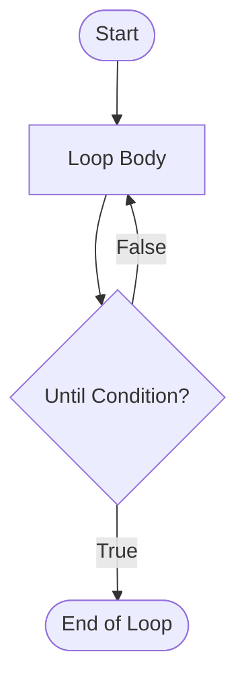
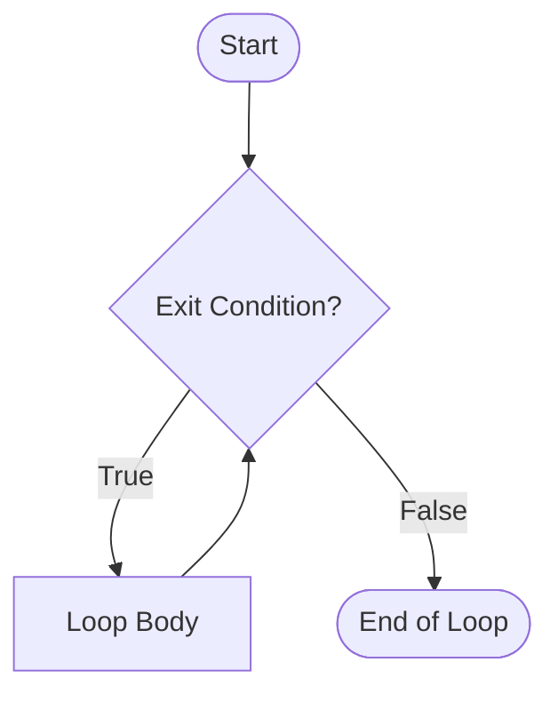

# GD-BASIC Language Reference

**Version:** 0.3.0  
**Interpreter:** GriCom Diminutive BASIC Interpreter  
**Language:** Java 21  
**Last Updated:** 2026-11-22

---

## Overview

This document describes the features and capabilities of the BASIC version implemented in this interpreter. The version is 
very similar to the original BASIC interpreters and additional functions are added to provide even more of the original functionality.

If the functionality of the interpreter does not match the documentation, refer to the error reporting processing in 
GitHub. Errors in the documentation can be reported and fixed as any software bug (Hint!).

> **Updated for v0.2.0**: The `#` suffix for real variables has been removed. Variables without a suffix now default to Real type (floating-point). Examples throughout this document reflect the current syntax.
>
> **Version 0.3.0 (branch `feature/bcd-arithmetic`, not yet merged)**: a variable with no suffix is REAL. `#` marks decimal (BCD) variables. `!` is the BOOLEAN suffix, and `@` is no longer a variable suffix (it gives an error). The status column in the variable table below says which rules are in version 0.3.0 and which are in the released 0.2.1 code.

> **Updated for v0.2.0+**: Interactive line editor now supports LOAD, SAVE, DELETE, and HELP commands. See Line Editor section below.

---

## Interactive Line Editor (v0.2.0+)

**Last Updated:** 2026-11-22

The GD-BASIC interpreter includes an interactive line editor for interactive program development. All program files are loaded into this editor by default.

### Editor Commands

#### LIST
Display the current program source code in order of line numbers.

**Syntax:** `LIST`

**Example:**
```
>LIST
10 PRINT "HELLO WORLD"
20 PRINT "This is line 20"
30 END
>
```

#### RUN
Parse and execute the current program. The program must contain at least one line.

**Syntax:** `RUN`

**Error if program is empty:**
```
>RUN
RUN: No program loaded. Use LOAD command or enter program lines.
```

#### LOAD
Load a BASIC program from a file, completely replacing the current program.

**Syntax:** `LOAD <filename>`

**Example:**
```
>LOAD myprogram.bas
Program loaded from myprogram.bas
```

**Errors:**
- File does not exist: `File not found: filename`
- File is empty: `Program file is empty: filename`

#### SAVE
Save the current program to a new file. **The file must not already exist** (prevents accidental overwriting).

**Syntax:** `SAVE <filename>`

**Example:**
```
>SAVE myoutput.bas
Program saved to myoutput.bas
```

**Error if file exists:**
```
>SAVE myoutput.bas
Error: File already exists: myoutput.bas
```

#### DELETE (Single Line)
Delete a single line from the program by line number.

**Syntax:** `DELETE <line-number>`

**Example:**
```
>DELETE 20
Deleted line 20
```

#### DELETE (Range)
Delete a range of lines (inclusive) from the program.

**Syntax:** `DELETE <start> <end>`

**Example (space-separated):**
```
>DELETE 10 20
Deleted lines 10 to 20
```

**Example (comma-separated):**
```
>DELETE 10,20
Deleted lines 10 to 20
```

#### HELP
Display help information for all editor commands and usage examples.

**Syntax:** `HELP`

**Output:** Displays comprehensive help text with:
- BASIC program entry syntax
- All editor commands
- Command syntax and examples
- Variable type information
- Usage notes

#### EXIT, BYE, QUIT
Exit the BASIC interpreter.

**Syntax:** `EXIT` or `BYE` or `QUIT`

**Example:**
```
>EXIT
Good bye.
```

### Entering Program Lines

To add or modify lines in the program, enter a line number followed by a space and the BASIC statement:

**Syntax:** `<line-number> <statement>`

**Example:**
```
>10 PRINT "HELLO"
>20 INPUT "Enter a number: "; N
>30 PRINT "You entered: "; N
>40 END
```

**Automatic Sorting:**
Lines are automatically sorted by line number. You don't need to enter them in order:

```
>30 END
>10 PRINT "Start"
>20 PRINT "Next"
>LIST
10 PRINT "Start"
20 PRINT "Next"
30 END
```

### Modifying Lines

To replace an existing line, re-enter the line number with the new statement:

```
>10 PRINT "Original"
>LIST
10 PRINT "Original"
>10 PRINT "Modified"
>LIST
10 PRINT "Modified"
```

### Multiple Statements Per Line

Use colons (`:`) to enter multiple statements on a single line:

```
>10 X = 5 : PRINT "X is "; X : X = X + 1
```

---

## GD-BASIC Language Syntax

## Introduction

This text starts with a correction. The `GD-BASIC` interpreter is not an interpreter in the pure sense of the 
definition of an interpreter as it does not react on entered words as they are entered and changes its state. It 
actually works more live a `JAVA` compiler, as it performs a lexical analysis of the program, then parses the 
result, and finally generates executable code that is run by a runtime module. In this version all three 
components are in one project / `JAVA` executable, but as a plan the runtime components might end up in a 
separate component.

`GD-BASIC` is also not a compiler as it does not generate machine code, but `JAVA` objects that are executed in 
sequence. At this time of the work that saves the translation into
platform-dependent code and keeps the platform migrate-able - it shall run on Windows, Linux, and Mac OSX. The change to low level machine code might happen at a later stage.
It is not planned, as the performance of a standard laptop or even Raspberry Pi is enough to outperform any 
classical BASIC computer.

The focus at this time of the work is to provide a function complete, extended `JAVA` based interpreter that can work standalone or can be embedded in `JAVA` programs, following
the example of `JRUBY` for Ruby or `JYTHON` for Python.

## Standards and supported Basic Implementations

GD-BASIC is based on the **Dartmouth BASIC October 1964** specification, the original and definitive version of the BASIC programming language. The implementation maintains backward compatibility with the original Dartmouth BASIC while adding modern extensions for enhanced functionality.

**Primary Reference**: [Dartmouth BASIC October 1964 Manual](doc/Dartmouth_BASIC_Oct64.pdf)

#### `GD-BASIC`

| Type | Variable Name Structure | Values | Status |
|------|-------------------------|--------|--------|
| `REAL` (double precision) | `AB` (no suffix) | 1, 1.01, 3.14 | Implemented |
| `INTEGER` | `AB%` (32-bit) | 1, 2, 9999 | Implemented |
| `LONG` | `AB&` (64-bit) | 1, 2, 9999 | Implemented |
| `STRING` | `AB$` (note: without the backslash, this has been added by Markdown) | "A Text" | Implemented |
| `BOOLEAN` | `AB@` | `true` or `false` | Released 0.2.1 only. In 0.3.0 `@` gives an error |
| `BOOLEAN` | `AB!` | `true` or `false` | Implemented in 0.3.0. In 0.2.1 `!` is DOUBLE |
| `BCD` (decimal) | `AB#` (up to 40 significant digits) | 1.5, 0.1, 1234.56 | Implemented in 0.3.0. In 0.2.1 `#` is rejected |

**Status column:** "Implemented" means the behaviour is in the code. Where the status says "0.2.1 only" or "In 0.2.1", the rule of the released code is shown. The decisions and their status are listed in `doc/GD-BASIC_Detailed_Design.md`, section "Decision register".

#### Suffix rules and ambiguities (version 0.3.0)

The suffix set is `%`, `$`, `#`, `&`, `!`. A character is read as a suffix only when:
1. the character before it is a letter, a digit or another suffix (`Normalizer.java`), and
2. the character after it is a space, an operator, `(`, `)`, `,`, `;`, `:` or the end of the line.

| Case | What happens | Rule for programmers |
|------|--------------|----------------------|
| `A#` followed by a space, operator, bracket or end of line | BCD variable `A` | Normal use |
| `A! = TRUE` or `A!=TRUE` | Boolean assignment to `A`. A number is converted: 0 gives TRUE, any other number gives FALSE | Use `!` for true-or-false names |
| `A != 2` | Not-equal comparison. The `!` is not after a name, so it is the operator | Put a space before `!=` in comparisons |
| `10#` | Syntax error when the program is parsed: `the decimal suffix '#' cannot follow a number` | Do not put a suffix on a number. Decimal constants have no suffix |
| `A@` | Syntax error: `uses '@', which is not a variable suffix. Use '!' for true or false` | Use `!` for true-or-false names |
| `10 ! Comment` (a `!` as the first token of a line) | Accepted as a comment | Prefer `REM` for comments |
| `10 PRINT A : ! Comment` (a `!` after a colon) | Accepted with a warning (`Comment after colon: use REM in place of !`) | Use `REM` for comments |
| `@PRAGMA` | Pragma keyword (`ReservedWords.java`) | Pragmas use `@`, not `#` |
| `X % 5`, `X & 5` | Operators, because a space comes before them | Keep spaces around `%` and `&` used as operators |

Decision D5 keeps the internal type name `DOUBLE` for untyped variables. Users see it as REAL.

## Document Conventions

In this document, a number of different symbols and placeholders are used. The following list declares these symbols and
gives a high level overview on their expected use.

| Used Symbol  | Description |
|--------------|-------------|
| `<line_number>` | for `BASIC` only. Line numbers are integer values at the beginning of each command line. |
| `<statement>` | a statement is a command, comment, assignment (which could be understood as a special form of a command), or condition. |
| `<comment>` | a comment is a command with no function, entered to document the program. |
| `<assignment>` | an assignment is a command that assigns a value (string, numeric, or boolean) to a variable. |
| `<command>` | a command is an expression in the program that changes the state of the process. For details, refer to the command section of this document. |
| `<condition>` | a condition is a comparing statement that ends with a result, either `true` or `false`. For details, refer to the section on control statements in this document.|
| `<number>` | a number is an integer used for programming purposes. |
| `<expression>` | an expression is part of an assignment, reflecting the call to a function or a mathematical formula. |


## Language Elements

#### Structure of BASIC Programs
**Reference**: [Dartmouth BASIC October 1964 Manual](doc/Dartmouth_BASIC_Oct64.pdf), Section 1.1 - Program Structure

The Dartmouth version of the program structure consists of a program line in two parts:
1. A line number, which is a unique integer ahead of every single line. This number has to be constantly growing in 
   respect to the previous number, but it does not have to consecutive (actually it is good practice to show 
   functional blocks by the numbering scheme).
2. One or more actual commands (see the use of the colon in the next paragraph).

An example of a BASIC program following the Dartmouth format follows here:

__Example of a BASIC Program__

     10 REM Recorded of the JASIC Program in Dartmouth 
     20 REM Basic Format
     30 COUNT = 5
     40 COUNT = COUNT * 2
     50 REM Stop looping if we are done
     60 IF COUNT == 0 THEN
     70 GOTO 120
     80 END-IF
     90 PRINT "Hello, world!"
    100 REM Decrement and restart the loop
    110 COUNT = COUNT - 1
    120 GOTO 50
    130 END

Note: All BASIC implementations started following the Dartmouth format. Newer versions have moved to the format of 
the JASIC / GW-BASIC programming style. `GD-BASIC` is in the process to gain functional completeness and will not 
increase the JASIC programming feature until the Dartmouth version is functional complete.

##### Use of the Colon in the program line
The Colon is used to have multiple BASIC commands in a single command line:

    20 REM Colon Example
    30 COUNT = 5 : MULTIPLIER = 2
    40 COUNT = COUNT * MULTIPLIER


### Variables, Arrays, and Constants
Basic is a strongly typed programming language, which means that type conversion can only be done using conversion functions. These functions 
will be implemented in one of the next versions of the interpreter.

Implemented types are REAL numbers (double precision Java `double`, for variables with no suffix), decimal numbers (`#`, BCD, see
"Decimal Numbers (BCD)"), INTEGER (`%`), LONG (`&`), STRING (`$`) and BOOLEAN (`!`). Strings should be in "double quotes".

Variables are identified by name which must start with a letter and can contain letters or numbers. Case is significant for names and keywords.

Arrays are supported as of this version. An array is marked by round brackets directly connected to the variable name: `A$(10)`.
No whitespace is permitted between the variable and the index. The initial size of the array can be defined with the `DIM` command,
this is optional (every array is recognized), but has performance advantages. Different from other BASIC versions, this interpreter
does not limit to the use of the array to the reserved space. If the index is exceeded the current assigned space, additional memory
is made available, if available.

Example of Arrays:

    A$(10) = "This is the 10th field of the array"
    A(5) = a(4) + 1

>[!Warning]
> Two dimensional arrays must not have any space or tab characters between the denominators of the array:
> `A$(X,Y)` is supported, but `A$(X, Y)` is not and is causing an execution error.

Constants are not supported. All variables are globally scoped.

Variables are case-sensitive, so the variables `A%` and `a%` are different.

#### Reals or Numbers
Named Reals or Numbers, these variable types represent floating-point variables.
They provide the most coverage of mathematical functions, and the largest number
range. It is the default representation of variables in the interpreter.

*Note:* This version does only support double length floating-point variables, as 
this variable type is already implemented using the largest representation.

#### Decimal Numbers (BCD)
A variable whose name ends with `#` holds a decimal (Binary Coded Decimal) number. Decimal
numbers keep the digits you type, so `0.1 + 0.2` gives exactly `0.3`. This type is implemented in version 0.3.0
(branch `feature/bcd-arithmetic`).

```basic
10 AMOUNT# = 1234.56
20 RATE# = 0.035
30 INTEREST# = AMOUNT# * RATE#
40 PRINT INTEREST#
```

Running this program prints `43.2096`.

Rules:
- A decimal variable holds up to **40 significant digits**. Shorter numbers are stored at their natural length.
- A result that needs more than 40 digits in its whole-number part raises an overflow error (`OverflowException`).
- Digits after the decimal point are rounded so the result fits in 40 significant digits (rounding mode HALF_UP, decision D7, confirmed by the owner on 2026-11-22).
- Mixing a decimal value with a REAL, INTEGER or LONG value gives a decimal result (decision D11). A REAL is converted with `BigDecimal.valueOf(double)`.
- Division by zero raises `DivideByZeroException`.
- Results are printed without trailing zeros.
- Trigonometric, logarithmic and exponential functions (`SQR`, `EXP`, `LOG`, `LOG10`, `SIN`, `COS`, `TAN`, `ATN`) accept decimal values.
- Arrays with a `#` suffix are rejected: `Syntax Error: arrays with the '#' (BCD) suffix are not supported yet`.
- Shift operators (`<<`, `>>`) take integer operands. A decimal value that is a whole number (for example `3.0`) is accepted; a value with a fraction (for example `3.9`) gives an error (see "Shift Operators").

#### Booleans
Booleans are variables with two possible results: True or False. The suffix is `!` (`FLAG! = TRUE`).
In version 0.2.1 the suffix was `@`; in version 0.3.0 `@` gives an error (see the suffix rules above).

##### Definition of the Boolean Algebra

| Additive | Multiplicative |
|----------|----------------|
| A + 0 = A | 0A = 0 |
| A + 1 = 1 | 1A = A |
| A + A = A | AA = A |
| A + non A = 1 | A (non)A = 0 |

#### Strings
Strings are lists of characters. In `GD-BASIC`, even single characters are represented as strings. To mark the border of
strings, each string is surrounded by quotation marks (`"`).

Allowed operations for strings are:
- `==` - compares two strings
- `+` - concatenates two strings
- `[]` - retrieves a single character in a string:

      10 A$ = "Test"
      20 PRINT A$[1]

prints the character `e`

### Naming Conventions and Support

### Shift Operators (`<<`, `>>`)

The shift operators move the bits of an integer. Both operands are taken as **integers** (owner decision, 2026-11-22).

| Left operand | Right operand (number of bits) | Result |
|--------------|--------------------------------|--------|
| INTEGER, or a whole number (REAL, LONG or BCD) | INTEGER, or a whole number (REAL, LONG or BCD) | INTEGER |

- `a << n` multiplies `a` by 2 to the power `n`. `1 << 3` gives `8`.
- `a >> n` divides `a` by 2 to the power `n`, rounding down. `256 >> 4` gives `16`, and `-5 >> 1` gives `-3`.
- A number literal such as `1` or `3` is a REAL value, but a whole number is accepted as an integer. `1 << 3` works.
- An operand with a fraction is an error: `3.9 << 2` stops the program with `Operator '<<' needs whole numbers within the INTEGER range, but got 3.9`.
- An operand outside the INTEGER range (about -2.1 billion to 2.1 billion) is an error.
- A text or true-or-false operand is an error: `Operator '<<' needs integers, but got ...`.
- The shift count uses only its low five bits, as in Java. `1 << 40` gives `256`, and `1 << -1` gives `-2147483648`. This is the behaviour of the code. Whether a count outside 0 to 31 should be an error is an open question.

Example:

```basic
10 four% = 4
20 PRINT 1 << 3        REM 8
30 PRINT 256 >> four%  REM 16
40 END
```

## Reserved Words
The following keywords are reserved and cannot be used for variables. The following list defines the use of the keywords:

- `implemented`: the keyword is actively used in the interpreter
- `planned`: the keyword is used in the current development and/or released as a beta
- `reserved`: the keyword might be used in the future or is already on the roadmap. Do not use these keywords in order to be compatible in the future.

| Reserved Word |  `GD-BASIC` | Jasic | 
|---------------|-----------|-------|
| `ABS` | implemented | |
| `AND` | implemented | |
| `ASC` | implemented | |
| `ATN` | implemented | |
| `CALL` | implemented | |
| `CDBL` | implemented | |
| `CHR` | implemented | |
| `CINT` | implemented | |
| `CLOSE` | reserved | |
| `CLS` | reserved | |
| `CMD` | reserved | |
| `CONT` | reserved | |
| `COS` | implemented | |
| `DATA` | implemented | |
| `DEF FN` | planned | |
| `DIM` | depreciated | |
| `DO` | implemented | |
| `ELSE` | implemented | |
| `END` | implemented | |
| `END-IF` | implemented | |
| `END-WHILE` | implemented | |
| `EOF` | implemented | |
| `EOL` | reserved | |
| `ERL` | reserved | |
| `ERR` | reserved | |
| `EXIT` | planned | |
| `EXP` | implemented | |
| `FCLOSE` | implemented | |
| `FOPEN` | implemented | |
| `FOR` | implemented | |
| `FINPUT` | implemented | |
| `FREE` | reserved | |
| `FPRINT` | implemented | |
| `GOSUB` | implemented | |
| `GOTO` | implemented | implemented |
| `IF` | implemented | implemented |
| `INSTR` | implemented | |
| `INPUT` | implemented | implemented |
| `LEFT` | implemented | |
| `LEN` | implemented | |
| `LET` | depreciated | |
| `LOG` | implemented | |
| `MEM` | implemented | |
| `MID` | implemented | |
| `NEXT` | implemented | |
| `NOT` | implemented | |
| `ON` | reserved | |
| `OPEN` | reserved | |
| `OR` | implemented | |
| `PRINT` | implemented | implemented |
| `RANDOM` | reserved | |
| `READ` | implemented | |
| `REM` | implemented | |
| `REMINDER` | reserved | |
| `RETURN` | implemented | |
| `RIGHT` | implemented | |
| `RND` | implemented | |
| `SHIFT_LEFT` | implemented (operator `<<`, see Shift Operators) | |
| `SHIFT_RIGHT` | implemented (operator `>>`, see Shift Operators) | |
| `SIN` | implemented | |
| `SQR` | implemented | |
| `STEP` | implemented | |
| `STOP` | planned | |
| `STRING` | reserved | |
| `STR` | implemented | |
| `SYSTEM` | implemented | |
| `TAB` | reserved | |
| `TAN` | implemented | |
| `THEN` | implemented | implemented |
| `TIME` | implemented | |
| `TO` | implemented | |
| `UNTIL` | implemented | |
| `VAL` | implemented | |
| `WEND` | implemented (alias of END-WHILE) | |
| `WHILE` | implemented | |
| `+` | implemented | implemented |
| `-` | implemented | implemented |
| `*` | implemented | implemented |
| `/` | implemented | implemented |
| `:` | reserved | implemented |
| `>` | implemented | implemented |
| `=>` | implemented | |
| `<` | implemented | implemented |
| `=<` | implemented |  |
| `=` | implemented | implemented |
| `:=` | reserved | |
| `==` | implemented | |
| `!=` | implemented | |
| `^` | implemented | |
| `'` | implemented | |
| `&&` | implemented | |
| `||` | implemented | |

## Statements

###### BASIC Syntax
Each statement is on its own line. It starts with an integer number, which is increasing for each following line. Duplicates 
of the line numbers is not allowed. The structure of a statement is:

    <line_number> <comment | assignment | command>

Example:

    100 PRINT "This is an example"

### File I/O

GD-BASIC provides a set of commands for file operations, allowing programs to create, write, read, and manage files on the system.

#### FOPEN

The `FOPEN` command opens a file for either reading or writing.

###### BASIC Syntax
`FOPEN <file_id> "<filename>" "<mode>"`

- `<file_id>`: An integer (1-9) used to identify the file in subsequent commands.
- `<filename>`: The name of the file to open (string).
- `<mode>`: Either `"read"` to open an existing file for reading, or `"write"` to create a new file (or overwrite an existing one) for writing.

Example:
```basic
10 FOPEN 1 "data.txt" "write"
```

#### FPRINT

The `FPRINT` command writes data to an open file.

###### BASIC Syntax
`FPRINT <file_id> <expression> [, <expression> ...] [;]`

- `<file_id>`: The ID of a file opened in `"write"` mode.
- `<expression>`: One or more expressions (strings, numbers, etc.) to write to the file.
- `;`: A trailing semicolon prevents the command from writing a newline (CRLF) at the end.

Items are written next to each other with no space added between them. Put the spaces inside the strings yourself.

Example:
```basic
20 FPRINT 1 "Name: ", N$, " Age: ", A%
30 FPRINT 1 "No newline after this";
```

#### FINPUT

The `FINPUT` command reads a single line from an open file into a variable.

###### BASIC Syntax
`FINPUT <file_id> <variable>`

- `<file_id>`: The ID of a file opened in `"read"` mode.
- `<variable>`: The variable where the read line will be stored.

A comma after the file ID is optional: `FINPUT 1, L$` and `FINPUT 1 L$` both work.

Example:
```basic
40 FINPUT 1 L$
```

#### FCLOSE

The `FCLOSE` command closes a previously opened file.

###### BASIC Syntax
`FCLOSE <file_id> "<action>"`

- `<file_id>`: The ID of the file to close.
- `<action>`: Either `"KEEP"` to save the file, or `"DELETE"` to remove the file from the system after closing. `"DELETE"` also works for files opened in `"read"` mode.

Example:
```basic
50 FCLOSE 1 "KEEP"
```

#### EOF

The `EOF` function checks if the end of a file has been reached.

###### BASIC Syntax
`EOF(<file_id>)`

Returns `true` (boolean) if the end of the specified file has been reached, or `false` otherwise.

**Note:** The EOF flag is set to true only when an attempt is made to read past the end of the file. Simply reading the last line of a file does not set EOF to true—it becomes true on the next read attempt. `FGET` and `FPEEK` also set EOF when they reach the end, so a loop `WHILE NOT EOF(1)` that uses them ends.

Example:
```basic
60 IF EOF(1) THEN PRINT "End of file reached"
```

#### FGET

The `FGET` command reads a single character from an open file and advances the file position by 1.

###### BASIC Syntax
`FGET <file_id>, <variable>`

- `<file_id>`: The ID of a file opened in `"read"` mode.
- `<variable>`: The variable where the read character will be stored.

Returns the character as a string, or "EOF" if end of file is reached. The read position advances by 1 character. The file is not closed and re-opened, so an `FINPUT` on the same file continues from the right place.

Example:
```basic
10 FOPEN 1 "data.txt" "read"
20 FGET 1, C$
30 PRINT "Character: "; C$
40 FCLOSE 1 "KEEP"
```

#### FPEEK (NEW - May 30, 2026)

The `FPEEK` command reads the next character from a file WITHOUT advancing the read position. This provides lookahead capability.

###### BASIC Syntax
`FPEEK <file_id>, <variable>`

- `<file_id>`: The ID of a file opened in `"read"` mode.
- `<variable>`: The variable where the peeked character will be stored.

Returns the next character as a string, or "EOF" if end of file is reached. The read position is NOT advanced.

Key Difference from FGET:
- `FGET`: Reads character AND advances position
- `FPEEK`: Reads character WITHOUT advancing position (lookahead)

Example:
```basic
10 FOPEN 1 "data.txt" "read"
20 FPEEK 1, C$           ! Look ahead
30 IF C$ == "X" THEN PRINT "Found X ahead"
40 FGET 1, ACTUAL$       ! Now read it
50 FCLOSE 1 "KEEP"
```

#### FPUT (NEW - May 30, 2026)

The `FPUT` command writes a character or string to an open file WITHOUT adding a newline.

###### BASIC Syntax
`FPUT <file_id>, <expression>`

- `<file_id>`: The ID of a file opened in `"write"` mode.
- `<expression>`: Expression evaluates to character/string to write.

Unlike FPRINT, FPUT does not add a newline (CRLF) after the output. Useful for building lines character-by-character.

Key Difference from FPRINT:
- `FPRINT`: Writes with newline
- `FPUT`: Writes without newline

Example:
```basic
10 FOPEN 1 "output.txt" "write"
20 FPUT 1, "H"
30 FPUT 1, "e"
40 FPUT 1, "l"
50 FPUT 1, "l"
60 FPUT 1, "o"
70 FPRINT 1, ""           ! Add newline at end
80 FCLOSE 1 "KEEP"
```

#### FRENAME (NEW - May 30, 2026)

The `FRENAME` command renames or moves a file tracked by a file ID.

###### BASIC Syntax
`FRENAME <file_id>, "<new_filename>"`

- `<file_id>`: The ID of the file to rename.
- `<new_filename>`: The new filename (may include path).

The file is closed (without deletion) and renamed in the file system. The file ID remembers the new name, and the file stays closed, so you can open it again with `FOPEN`. Content is preserved. The file ID may be used after `FCLOSE` too, because its last name is still known.

Example:
```basic
10 FOPEN 1 "temp.txt" "write"
20 FPRINT 1, "Important data"
30 FCLOSE 1 "KEEP"
40 FRENAME 1, "backup.txt"     ! Rename file
50 PRINT "File renamed to backup.txt"
60 END
```

#### FREWIND (NEW - May 30, 2026)

The `FREWIND` command resets the file read position to the beginning of the file without closing it.

###### BASIC Syntax
`FREWIND <file_id>`

- `<file_id>`: The ID of a file opened in `"read"` mode.

The file position is reset to 0, allowing re-reading from the start. The file remains open, making this more efficient than closing and reopening.

Example:
```basic
10 FOPEN 1 "data.txt" "read"
20 PRINT "First pass:"
30 GOSUB 100
40 FREWIND 1                   ! Go back to start
50 PRINT "Second pass:"
60 GOSUB 100
70 FCLOSE 1 "KEEP"
80 END
100 REM Process file
110 WHILE NOT EOF(1)
120    FINPUT 1, L$
130    PRINT L$
140 WEND
150 RETURN
```

### Comments
Comments start with ' and proceed to the end of the line:

    PRINT "hi there" ' this is a comment

### Assignments

Assignments are made in the form "\<name\> `=` \<expression\>".

They evaluate the expression on the right and assigns the result to the given named variable. 

###### BASIC Syntax
The implemented BASIC version supports real numbers and negative numbers:

    PI# = 3.14159
    A% = -1

*Note*: 
For the Basic language, the assignment equal (`=`) is different from the comparison equal (`==`). For the assignment 
operation only the assignment operator can be used. The comparison user is generating an error...

### Expression Evaluation Modes

GD-BASIC supports two expression evaluation modes to maintain compatibility with different BASIC dialects:

#### Dartmouth Mode (`_bDartmouthFlag = true`)
**Reference**: [Dartmouth BASIC October 1964 Manual](doc/Dartmouth_BASIC_Oct64.pdf)

Follows the original Dartmouth BASIC specification with **left-to-right evaluation**:
- All operators have equal precedence
- Expressions are evaluated strictly from left to right
- Example: `1 + 2 * 3` evaluates as `(1 + 2) * 3 = 9`

#### Standard Precedence Mode (`_bDartmouthFlag = false`)
Follows modern mathematical operator precedence:
- Standard mathematical precedence rules apply
- Example: `1 + 2 * 3` evaluates as `1 + (2 * 3) = 7`

**Usage**: The evaluation mode is selected when creating the parser:
```java
// Dartmouth mode (original BASIC behavior)
Parser parser = new BasicParser(tokens, true);

// Standard precedence mode (modern behavior)
Parser parser = new BasicParser(tokens, false);
```

### Commands

As the previous section described variables and variable types, this section describes commands and command structure. 
In sequence, this section describes:
- Loops and Iterations
- Input and Output Commands
- Control Structures / Process Control
- Expressions and Mathematical Functions

Finally, special function of the `GD-BASIC` implementations are discussed, such as the `SYSTEM` interface and the `CALL` function.
Those features are implemented in the current release.

#### Loops and Iterations

This section of the BASIC programming guide describes the three different loops `GD-BASIC` provides:
- the `WHILE`-loop, which is a check-first style loop: The condition for the loop is checked before the loop is executed,
- the `DO`-loop, which is an execute-first loop: The loop body is executed before the repetition of the loop is 
  verified, and
- the `FOR`-loop, which is a counting loop: the loop counts a value from a start to an end in certain step sizes.

Only the `FOR`-loop can be found in standard BASIC literature, the `WHILE` and the `DO` loops are extensions implemented
in other BASIC dialects - and proven useful.

##### `DO` Command
The `DO` - Loop has a different nature. This loop will execute the loop at least once, before verifying the continuation of the loop at the
end. The structure of the loop can be seen in the following chart:



`DO <statement> EXIT <statement> UNTIL <condition>`

###### BASIC Syntax

    10 X# = 0
    20 DO
    30  PRINT X#
    40  X# = X# + 1
    50 UNTIL X# >= 10

###### `EXIT` Command
The `EXIT` command terminates the `WHILE` and the `DO` loop immediately and continues with the first command after the `END-WHILE` or the `UNTIL`
statement.

###### `UNTIL` Command
The `UNTIL` command closes the `DO` loop. It contains the exit condition, which needs to be true in order to lease the loop. If the
condition is false, the loop will return to the `DO` command and will continue from there.

###### References
This loop is known in other programming languages or dialects as:
- `REPEAT-UNTIL` - loop, or
- `DO - LOOP UNTIL` - loop

##### `FOR` Command
The FOR loop is a command that counts a variable from a start value (in the initial expression) to an end value 
(after the `TO` part of the command),
using increments defined by the `STEP` command.
Between the increment number after the step and the `NEXT` command, which triggers the next iteration, the developer can include one or multiple commands.
The syntax looks as follows:

`FOR <variable> = <number> TO <number> STEP <number> <statement> NEXT`

###### BASIC Syntax

Example for a FOR loop counting upwards from -2 to 2 in increments of 0.2 and printing the value of the variable:

    50 FOR X# = -2 TO 2 STEP .2
    60 PRINT X#
    70 NEXT
    80 REM Test2

Example for a FOR loop counting downwards from 2 to -2 in decrements of -0.2 and printing the value of the variable:

    140 PRINT "Downwards..."
    150 FOR Y# = 2 TO -2 STEP -.2
    160 PRINT Y#
    170 NEXT

##### `WHILE` Command
The `WHILE` - loop is a head-checking loop, i.e. the condition to execute the loop is checked before the loop is executed.
The following chart describes the loop structure:



The syntax of the `WHILE` loop is as follows:

`WHILE <condition> <statement> EXIT <statement> END-WHILE`

`WEND` is a second spelling of `END-WHILE` (version 0.3.0).

###### BASIC Syntax

    210 WHILE X# < 3
    220 PRINT X#
    230 X# = X# + 1
    240 END-WHILE

###### `EXIT` Command
The `EXIT` command terminates the `WHILE` and the `DO` loop immediately and continues with the first command after the `END-WHILE` or the `UNTIL`
statement.

##### `INPUT` Command
`INPUT <variable>`

Reads in a line of input from the user and stores it in the variable with the given name.

    INPUT guess$

##### `READ` Command
`READ <variable>,... <variable>`

The `READ` command is reading the data in the `DATA` block into a single or multiple variables. The variables are 
separated by commas `,`. If the number of `READ` requests exceeds the available entries in the `DATA` block, the program 
will terminate with an Out Of Data Exception. 

    READ guess$

###### `DATA` Command
`DATA <value>,..., <value>`

The `DATA` command is pre-defining data blocks for the use of the `READ` command.

    DATA "value1", 123, "value2", 456

##### `PRINT` Command  

`PRINT <expression>`

Evaluates the expression and prints the result.

    PRINT "hello, " + "world"

The `PRINT` command terminates its output with CRLF (Carriage return / line feed) character, the next output is at the beginning
of a new line. By ending the `PRINT` command with a semicolon (`;`), the CRLF character sequence is not printed, the next output starts
after the last output printed.

Example:

    10 PRINT "These two commands ";
    20 PRINT "will print in the same line."

Output:

    These two commands will print in the same line.

The `PRINT` command also allows printing multiple fields in the same command. These fields are separated by a comma
(`,`) or a semicolon (`;`).

Example:

    160 PRINT a#, " x 2 = ", b#;

*NOTE:* a comma adds no space between the printed values. `PRINT 1,2` prints `1.02.0`. To get a space, put it inside the string itself, for example `PRINT "Total: ", X`.
A function call can be printed directly: `PRINT LEN(x$)`.

### Process Control

#### Unconditional Process Control (Jump)

##### `GOSUB` Command

`GOSUB <line_number> <statements> RETURN`

Jumps to the statement at the given line number. Processes the program from that location on until the `RETURN` command is found.
Returns to the next statement past the command.

      100 GOSUB 200
      110 PRINT "Second line output"
      120 END


      200 PRINT "First line output"
      210 RETURN

###### `RETURN` Command

*NOTE:* The `RETURN` command assumes that a prior `GOSUB` command has been executed. If the `RETURN` is found without a prior `GOSUB` the
location for further processing is not predicable, if possible an error is thrown.


##### `GOTO` Command

The `GOTO` command represents the unconditional jump to another location in the program without return after completion 
(different to the `GOSUB` command). The command will not change any variable content or any status of the program, just 
will move the program pointer to the new location.

`GOTO <line_number>`

Jumps to the statement at the given line number. Processes the program from that location on.

      10 PRINT "Hello"
      20 GOTO 10

##### `ON GOTO` Command (v0.2.1+)

The `ON GOTO` command represents a computed (dynamic) jump based on the value of an expression. It evaluates 
an expression to an integer and uses that value to select a target line number from a list.

`ON <expression> GOTO <line1>, <line2>, <line3>, ...`

The expression is evaluated to determine the index (1-based):
- If expression evaluates to 1, jumps to line1
- If expression evaluates to 2, jumps to line2
- If expression evaluates to 3, jumps to line3
- etc.

If the index is out of range (< 1 or > number of targets), the program continues to the next statement 
without jumping (graceful fallthrough).

**Examples:**

```basic
10 INPUT "Choose (1-3): "; CHOICE%
20 ON CHOICE% GOTO 100, 200, 300
30 PRINT "Invalid choice"
40 GOTO 9999
100 PRINT "Option 1 selected"
110 GOTO 9999
200 PRINT "Option 2 selected"
210 GOTO 9999
300 PRINT "Option 3 selected"
9999 END
```

**With expression:**

```basic
10 X% = 2
20 Y% = 1
30 ON X% + Y% GOTO 100, 200, 300
40 PRINT "Invalid choice"
50 GOTO 9999
100 PRINT "Sum is 1"
110 GOTO 9999
200 PRINT "Sum is 2"
210 GOTO 9999
300 PRINT "Sum is 3"
9999 END
```

**Features:**
- Expression is evaluated at runtime (supports variables and complex expressions)
- Real numbers are automatically converted to integers (2.7 → 2)
- 1-based indexing (follows BASIC tradition)
- Out-of-range indices continue normally without error

##### `ON GOSUB` Command (v0.2.1+)

The `ON GOSUB` command is similar to `ON GOTO` but calls a subroutine instead of performing an unconditional jump. 
It evaluates an expression to an integer and uses that value to select a target subroutine from a list. 
The return address is saved on the stack for the `RETURN` command.

`ON <expression> GOSUB <line1>, <line2>, <line3>, ...`

Works identically to `ON GOTO` but:
- Pushes the return address onto the stack before jumping
- Works seamlessly with the `RETURN` command
- Allows nested subroutine calls

**Example:**

```basic
10 INPUT "Choose (1-3): "; CHOICE%
20 ON CHOICE% GOSUB 100, 200, 300
30 PRINT "Program returned from subroutine"
40 GOTO 9999
100 PRINT "Subroutine 1"
110 RETURN
200 PRINT "Subroutine 2"
210 RETURN
300 PRINT "Subroutine 3"
310 RETURN
9999 END
```

**Features:**
- Same indexing and expression handling as `ON GOTO`
- Saves return address for `RETURN` statement
- Supports nested subroutine calls
- Out-of-range indices continue normally without calling any subroutine

#### Conditional Process Control

##### `IF` Command

The BASIC version of the `IF` command supports to coding versions:

`IF <condition> THEN <statements> ELSE <statements> END-IF` and
`IF <condition> THEN <line_number>`

When the `IF` command is used, it evaluates the condition in the command. If this condition evaluates to a true 
value, then either the commands in the block between the `THEN` and the `END-IF` is executed, or the program jumps to 
the target line number. If it evaluates to a false value, the flow jumps to the block following the `ELSE` statement,
or if no `ELSE` block is available - it moves to the statement past the `END-IF` statement.

Examples:

a) using the `IF` block:

Without `ELSE` statement:

    10 IF a < b THEN 
    20   PRINT "Inside the IF block"
    30 END-IF 
    40 PRINT "Outside the IF block"


With `ELSE` statement:

    10 IF a < b THEN 
    20 PRINT "a is smaller than b"
    30 ELSE
    40 PRINT "a is larger or equal than b"
    30 END-IF 
    40 PRINT "Alwayas printed"

or

b) jumping directly to a target:

    10 IF a < b THEN 30
    20   PRINT "Only printed if a >= b"
    30 PRINT "Always printed"

###### Good and Bad Coding

Using the `GOTO` command inside the `IF` / `ELSE` / `END-IF` block is considered bad practice. It forces the interpreter to 
jump out of a non-finished block, and this can use to unwanted program behaviour. In this case, use the non-blocked 
version of the command.

## Expressions and Operators
The following expressions are supported:

* \<expression\> `=` \<expression\>:
  Evaluates to 1 if the two expressions are equal, 0 otherwise.

* \<expression\> `==` \<expression\>: (BASIC only)
  Evaluates to `true` if the two expressions are equal, `false` otherwise.
* \<expression\> `!=` \<expression\>: (BASIC only)
  Evaluates to `false` if the two expressions are equal, `true` otherwise.

* \<expression\> `+` \<expression\>:
  As of this version, the addition of two variables is supported for all
  data types. If the left-hand expression is a number, integer, or boolean 
  then adds the two expressions; otherwise concatenates the two strings.
  In this case the second value can be of any type, the variable will be
  converted to a string.

* \<expression\> `-` \<expression\>:
  The subtraction is supported for numbers and integers.

* \<expression\> `*` \<expression\>:
  Multiplication is supported for numbers, integers, and booleans.

* \<expression\> `/` \<expression\>:
  Division is supported for numbers and integers

* \<expression\> `<` \<expression\>

* \<expression\> `<=` \<expression\>

* \<expression\> `>` \<expression\>

* \<expression\> `>` \<expression\>

* \<expression\> `&` \<expression\> (or \<expression\> `AND` \<expression\>): Implements the logical `AND` operator. 
  The result is `true` only if both expressions provide a result that is interpreted as `true`.

* \<expression\> `|` \<expression\> (or \<expression\> `OR` \<expression\>): Implements the logical `OR` operator.
  The result is `true` only if one of the two expressions provides a result that is interpreted as `true`.

* \<name\>:
    A name in an expression simply returns the value of the variable with
    that name. If the variable was never set, it defaults to 0.

All binary (atomic) operators have the same precedence.

## Converting BASIC Programs to `GD-BASIC`
Programs written in a BASIC language other than `GD-BASIC` may require some minor adjustments before they can be run. The following
sections describe these adjustments.

### String and Array Dimensions
Delete all statements used to declare the length of strings or arrays. A statement such as the following

    DIM A$(I,J)

which dimensions a string array for `J` elements of length `I`, should be removed. Also removed should be and `DIM` statements:

    DIM A$(J)
    DIM A(H)

`GD-BASIC` does not support prior declaration of arrays and string sizes. Both are implemented as dynamically growing and
shrinking.

>[!Warning]
> Two dimensional arrays must not have any space or tab characters between the denominators of the array:
> `A$(X,Y)` is supported, but `A$(X, Y)` is not and is causing an execution error.

### String Functions
Some Basic languages use a comma `,` or ampersand `&` for string concatenation. Each of these must be changed to a plus sign `+`,
which is the operator for `GD-BASIC` string concatenation.

In `GD-BASIC`, the `MID$`, `RIGHT$`, and `LEFT$` functions will be used in a later release to take substrings of strings. Forms
such as `A$(I)` to access the `I`th character in `A$` are replaced by `A$[I]`, or `A$(I,J)` to take a substring of `A$` from
position `I` to position `J` must be replaced by `A$[I,J]` (later supported in a later version).

### Multiple Assignments
Some Basic languages allow statements of the following to set `B` and `C` equal to zero:

    10 LET B=C=0

`GD-BASIC` does not support this logic. GW-Basic interprets the statement in which the value B is set based on C equal to zero.
This will be needed to be changed to

    10 B = A == 0

### Multiple Statement
Some Basic languages use a backslash `\\` or colons `:` to separate statements on a single line. With `GD-BASIC`, make sure all elements on a line
only apply to a single command. the use of the colon `:` is not support in the current version.

### MAT Functions
Programs using the `MAT` functions available in some Basic languages must be rewritten to use `FOR-NEXT` loops to execute properly .

### FOR-NEXT Loops
Some `GD-BASIC` will always execute a `FOR-NEXT` loop once, regardless of the limits. Other Basic languages checks the limits first
and does not execute the loop if past limits.

## Implemented Functions

### Mathematical Functions

#### `ABS`
The `ABS` function returns the absolute (positive) value of the entered parameter. The function allows integer, real, and long values.

#### `ATN`
The function `ATN` returns the arch-tangens of the parameter given.  The parameter needs to be of type `real`.

#### `CDBL`
The function `CDBL` converts an `integer` value into the type `real`.  The parameter needs to be of type `integer`.

#### `CINT`
The function `CINT` converts a `real` or decimal (`#`) value into the type `integer`. The fraction is removed (truncation):
`CINT(3.7)` gives `3`.

The fraction is always removed (truncation). `CINT(-3.7)` gives `-3`. This is the rule of the code (owner confirmed, 2026-11-22).

#### `COS`
The function `COS` returns the co-sinus of the parameter given. The parameter needs to be of type `real`.

#### `EXP`
The function `EXP` gives the exponential value or the parameter to the base e. The parameter needs to be of type `real`.

#### `LOG`
The function `LOG` returns the logarithm naturalis of the parameter given. The parameter needs to be of type `real`.

#### `LOG10`
The function `LOG10` returns the logarithm decimalis of the parameter given. The parameter needs to be of type `real`.

#### `NOT`
The function `NOT` reverses the logical or boolean content of a variable and returns that content: `true` becomes 
`false` and vice versa.

For a number, `NOT` gives the bitwise complement: `NOT x` is `-x - 1`. `NOT 0` gives `-1`, `NOT 5` gives `-6`, `NOT -3` gives `2` (owner confirmed, 2026-11-22). `NOT TRUE` on an untyped (REAL) variable gives a type error.

#### `RND`
The `RND` function does not require any parameter. It returns a `REAL` value which is pseudo-randomly generated and between `0` and `1`.

#### `SIN`
The function `SIN` returns the sinus of the parameter given. The parameter needs to be of type `real`.

#### `SQR`
The function `SQR` returns the square root to the parameter given. The parameter needs to be of type `real`.

#### `TAN`
The function `TAN` returns the tangents of the parameter given. The parameter needs to be of type `real`.

### String Processing Functions

#### `ASC`
Convert an integer to a character using the ASCII Code

#### `CHR`
Convert a character to an integer using the ASCII Code

#### `LEFT`
Get the Left side of a string

#### `LEN`
Get the length of a string

#### `LOWER`
Convert a string to lowercase. All uppercase letters are converted to their lowercase equivalents; other characters remain unchanged.

**Example**: `LOWER("HeLLo WoRLd")` returns `"hello world"`

#### `MID`
Get the middle of a string. The positions are whole numbers (INTEGER, or REAL values with no fraction such as `2`).
A fractional position gives an error.

`MID$(text, start, end)` returns the characters from `start` to `end`, both included. `MID$("Hello", 2, 3)` gives `ll` (owner confirmed, 2026-11-22: the code is correct).

#### `INSTR`
Returns the one-based position of the first match, or `0` when the text is not found (version 0.3.0).

#### `RIGHT`
Get the right side of a string

#### `STR`
Convert a number to the string

#### `UPPER`
Convert a string to uppercase. All lowercase letters are converted to their uppercase equivalents; other characters remain unchanged.

**Example**: `UPPER("HeLLo WoRLd")` returns `"HELLO WORLD"`

#### `VAL`
Convert a string to a real number

### System Functions

#### `CALL`
The `CALL` function performs an HTTP POST request to a specified URL with a payload. It returns the response body as a string.

###### BASIC Syntax
`10 Return$ = CALL("<url>", "<payload>")`

- `url`: The full URL of the API endpoint (string).
- `payload`: The data to be sent in the POST request body (string).

The function sets the `Content-Type` and `Accept` headers to `application/json` by default. It has a default timeout of 10 seconds.

If the HTTP response status code is not in the 2xx range (e.g., 404, 500), the function throws a `RuntimeException` containing the status code and response body.

Example:
```basic
10 URL$ = "https://httpbin.org/post"
20 PAYLOAD$ = "{\"name\": \"GD-BASIC\", \"version\": \"0.1.0\"}"
30 RESPONSE$ = CALL(URL$, PAYLOAD$)
40 PRINT "API Response: ", RESPONSE$
```

#### `MEM`
The `MEM` function returns the size of the available memory as an integer. The function does not require any parameter.

#### `SYSTEM`
The `SYSTEM` executes a command on OS level. The function works is called with two parameters:
- Command: defines what the function is going to do: `RUN` executes a shell command, `START` executes any program 
  from the system. The first command returns the result of the execution as a `String` value - while the second 
  command starts any program, and does not return a result.
  
- Program: contains the command line to be executed, as a `String` value.

## Macro Processing

The macro processing is a two pass process: in the first pass, the macro processor class runs the lexer over the 
source code to find the `DEF` command. The actual macro is then added into the list of the macros. In the second 
pass, the macro processor replaces every occurrence of the macro in the code with the function defined in the `DEF` 
command.

#### `DEF` Command
The `DEF` command is used to define a macro. The macro processor is looking for the command and takes the left over 
of the command and processes it as a macro. This is happening during the first pass of the program.

The defined macro does not have a limit in the number of parameters. The following examples describe a set of typical 
defined macros:

    50 DEF FNA(X) = "X * 2"
    60 DEF FNB(X, Y) = "X * Y"
    70 DEF FNC(X, Y, Z) = "X * Y + Z"

The macros are called in the program as follows:

    120 X# = FNA(X#) * FNA(X#)


## Depreciated Basic Commands and Functions

The following standard Basic commands are depreciated and should not be used.

- The `LET` command is depreciated and will be ignored
- The `DIM` command is depreciated and will be ignored

The `SINGLE` data type of the old BASIC implementations does not exist in `GD-BASIC`. The developer is asked to use 
the simple integer data type. Therefore, the conversions functions are not implemented:

- The `CSNG` and `SNG` functions are not implemented
- The `CINT` and `INT` functions are identical, only CINT is implemented

## Compatibility To Other Implementations

### General Rules Concerning the Different Dialects
Every BASIC program consists of different elements:
* Variables,
* Statement and Commands, and
* Controls (which look like commands, but control the execution)

### Dartmouth BASIC
This Basic interpreter is targeted to implement the definition of the BASIC programming language as defined by Thomas Kurtz and John Kemeny
from [Dartmouth College](https://en.wikipedia.org/wiki/Dartmouth_BASIC).

The implementation follows the **Dartmouth BASIC October 1964** specification, which is the original and definitive version of the BASIC programming language. A copy of the original Dartmouth BASIC programming manual (`Dartmouth_BASIC_Oct64.pdf`) is included in the documentation for reference.

**Key Dartmouth BASIC Features Implemented:**
- **Line Numbers**: Every statement must begin with a line number
- **Variable Naming**: Single letter or single letter + single digit (e.g., A, A1, B, B2)
- **Expression Evaluation**: Left-to-right evaluation (Dartmouth mode with `_bDartmouthFlag = true`)
- **Built-in Functions**: Mathematical and string processing functions
- **Control Structures**: GOTO, IF-THEN, FOR-NEXT loops
- **Input/Output**: PRINT, INPUT, READ/DATA statements

**Dartmouth BASIC Resources:**
- [Dartmouth BASIC 50th Anniversary](https://www.dartmouth.edu/basicfifty/commands.html) - Online reference
- [Dartmouth BASIC October 1964 Manual](doc/Dartmouth_BASIC_Oct64.pdf) - Original specification document
- [Wikipedia: Dartmouth BASIC](https://en.wikipedia.org/wiki/Dartmouth_BASIC) - Historical overview

The language support is most complete for the Dartmouth version, with additional modern features added as extensions.

### ECMA Minimal Basic
The following link point to a [C Compiler for ECMA Minimal Basic](https://buraphakit.sourceforge.io/BASIC.shtml).
To ensure that this interpreter is compatible with the ECMA standard, the programs of the implementation are
added in the test area. A copy of the ECMA Basic standard document has been added to the documentation.

### Decimal BASIC
Decimal Basic seems to be an active Japanese BASIC implementation initiative that is working also from the
Dartmouth and ECMA standard. The project webpage can be found here: [Decimal Basic](http://hp.vector.co.jp/authors/VA008683/english/)
This link leads to an implementation of a Basic to Pascal translator, written by Shiraishi Kazuo:
[Basic to Pascal](http://hp.vector.co.jp/authors/VA008683/english/BASICAcc.htm).

### GDBasic
GDBasic is a superset of the different basic dialects. This document describes - apart from commonalities -
differences, where GDBasic programs exceed the different dialects.

### Types and Naming Standards

#### Dartmouth BASIC (October 1964)
Variable names can be a single letter, or a single letter followed by a
single digit. This provides for 286 possible variable names (26 letters × 11 digits including 0).

**Reference**: [Dartmouth BASIC October 1964 Manual](doc/Dartmouth_BASIC_Oct64.pdf), Section 2.1 - Variable Names

#### Applesoft Basic

| Type | Variable Name Structure | Values |
|------|-------------------------|--------|
| `REAL` | `AB` | +/- 9.9999999 E+37 |
| `INTEGER` | `AB%` | +/- 32767 |
| `STRING` | `AB$` | 0 to 256 Characters |

### Detailed Changes To The Existing Standards

### Differences any reviewed Basic Implementations

#### `DEF` Statement
GD-Basic does not need a macro defined before used in the code. As GD-Basic has a macro processor that runs 
multi-pass through the source code, the macro definition can be in the source code after the macro is referenced.

### Differences to GW-Basic

#### `IF` Statement
Different to GW-Basic, this interpreter allows the use of a command block following the `IF` command. In GW-Basic, 
the `IF` command is followed by a single command, followed by a potential `ELSE` command. `GD-BASIC` allows a block of 
commands, with the blocks terminating in an `ELSE` and `END-IF` statement.

## Known Issues and Workarounds

### `NEXT` before `REM` and `DATA`
As the `DATA` and `REM` command are not executing a command during the processing of the program, the interpreter 
will run into a problem if those commands are following directly a `NEXT` or `END-IF` command. This problem can be 
avoided by having another command (e.g. `PRINT`) following the next command.

As a best practice, put all `DATA` definitions after the `END` command. This way the error can be avoided. 
Resolution for this issue is not planned at the moment.

## Using an Integrated Development Environment (IDE)
At this moment the project contains the setting to allow syntax highlighting in Microsoft's Visual Studio Code. This 
extension can be installed as follows:

The VSC extension is located in `<PACKAGE>/etc/VSCExtension`. To install it, the content needs to be copied to `~/.vscode/extensions/gd-basic/`
When starting VSC, the extension should be visible:


As a result of the extension, Basic code in VSC should be optically supported:


## Alternative Projects and Information

* [Wikipedia Article on Basic](https://en.wikipedia.org/wiki/BASIC)
* [TinyBasic](https://en.wikipedia.org/wiki/Tiny_BASIC) with the related implementation for [Java](http://www.thisiscool.com/tinybasic.htm)
* [GW-Basic](https://en.wikipedia.org/wiki/GW-BASIC) is the Microsoft reference implementation of the BASIC 
  programming language

## Dartmouth BASIC Documentation Reference

### Primary Documentation
- **[Dartmouth BASIC October 1964 Manual](doc/Dartmouth_BASIC_Oct64.pdf)** - The original and definitive specification of the BASIC programming language
- **[Dartmouth BASIC 50th Anniversary](https://www.dartmouth.edu/basicfifty/commands.html)** - Online reference and historical information
- **[Wikipedia: Dartmouth BASIC](https://en.wikipedia.org/wiki/Dartmouth_BASIC)** - Historical overview and context

### Key Sections in the October 1964 Manual
- **Section 1.1**: Program Structure and Line Numbers
- **Section 2.1**: Variable Names and Naming Conventions
- **Section 3.1**: Expression Evaluation and Operator Precedence
- **Section 4.1**: Built-in Functions and Mathematical Operations
- **Section 5.1**: Control Structures (GOTO, IF-THEN, FOR-NEXT)
- **Section 6.1**: Input/Output Operations (PRINT, INPUT, READ/DATA)

### Implementation Notes
GD-BASIC implements the Dartmouth BASIC October 1964 specification with the following considerations:
- **Backward Compatibility**: Maintains original Dartmouth BASIC behavior when using `_bDartmouthFlag = true`
- **Modern Extensions**: Adds contemporary features while preserving core Dartmouth BASIC functionality
- **Documentation Alignment**: All Dartmouth BASIC features are implemented according to the original specification

### Changing the Interpreter behaviour (`@PRAGMA` directive)
The interpreter can change the behaviour of the runtime by using the `@PRAGMA` directive. The use of the directive 
can change the behaviour of the interpreter at the time from the point of the directive's usage. The syntax of the directive is:
```BASIC
60 @PRAGMA( "LOG_LEVEL" = "INFO" )
```
>[!Note]
> The `@pragma` needs a line number like all BASIC programming statements.

The following directives are supported:
- `@PRAGMA( bDartmouthFlag = true )` - Enables the Dartmouth BASIC mode. This is not tested yet.
- `@PRAGMA( "LOG_LEVEL" = "INFO" )` - Changes the log level of the interpeter.
