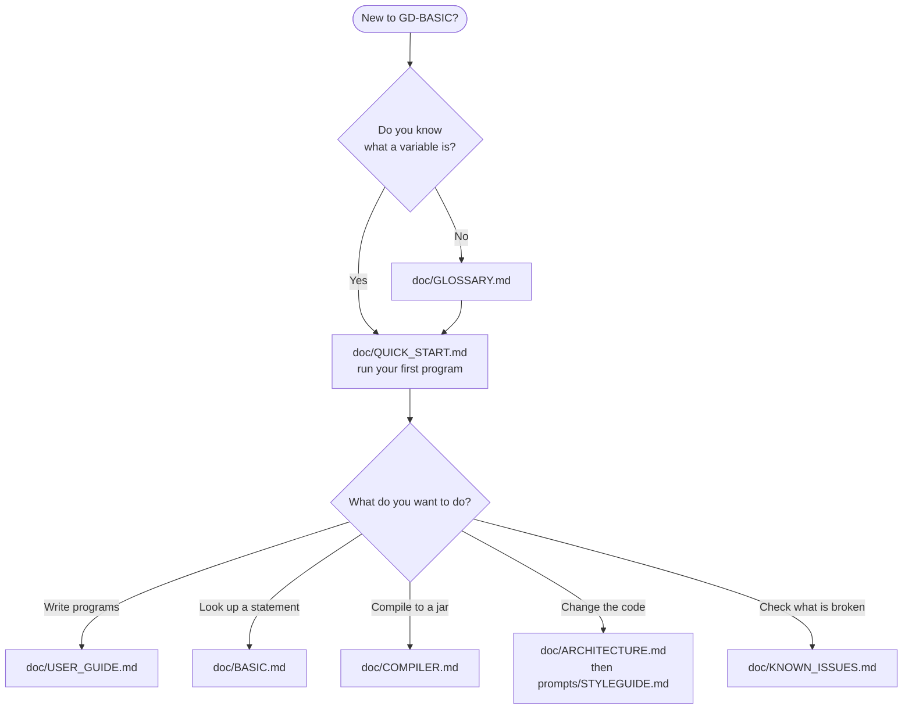

# GD-BASIC: Documentation Index

**Version:** 0.4.0 (branch `feature/compiler`, not yet merged) · **Checked:** 2026-11-23

This page lists every document in the project, says who it is for, and gives a reading path. It replaces an earlier
index that linked to 14 files which do not exist. Every link on this page was checked on 2026-11-23.

---

## 1. Where to start

---

## 2. Documents for everyone

| Document | What it is | Read it when |
|---|---|---|
| [`README.md`](../README.md) | The project front page: status, test results, quick start, folder layout. | First, to see the current state. |
| [`doc/QUICK_START.md`](QUICK_START.md) | A 15-minute guide. Every example was run on 2026-11-23. | You want to run a program now. |
| [`doc/GLOSSARY.md`](GLOSSARY.md) | Plain-English meanings of the words used in the documents. | A word is new to you. |
| [`doc/KNOWN_ISSUES.md`](KNOWN_ISSUES.md) | The open problems, with a repro program, the expected and actual output, and the source line. | A program does not behave as documented. |
| [`CHANGELOG.md`](../CHANGELOG.md) | The version history, including what changed on each day in 0.4.0. | You want to know what changed. |

## 3. Documents for users of the language

| Document | What it is | Status (2026-11-23) |
|---|---|---|
| [`doc/USER_GUIDE.md`](USER_GUIDE.md) | How to run the interpreter, the command-line options, the editor, and troubleshooting. | Checked for the options and editor commands. |
| [`doc/BASIC.md`](BASIC.md) | The language reference: syntax, variable types, operators, the reserved-word table with a status for each word, statements and functions. | Reserved-word table rebuilt and checked. Statements not re-run are marked as such. |
| [`doc/BASIC_CODING_STANDARD.md`](BASIC_CODING_STANDARD.md) | Rules for writing BASIC programs, and the history of older suffix rules (0.1.x to 0.2.0). | Older sections are history. The suffix table is current. |

## 4. Documents for developers

| Document | What it is | Status (2026-11-23) |
|---|---|---|
| [`doc/ARCHITECTURE.md`](ARCHITECTURE.md) | How the parts fit together: the package map (measured), the execution pipeline, the decimal value path and the compiler path, with diagrams. | Updated 2026-11-23. |
| [`doc/GD-BASIC_Detailed_Design.md`](GD-BASIC_Detailed_Design.md) | The full design: every package, its classes, and the decisions. Long reference document. | Older sections may still describe 0.2.x. See KNOWN_ISSUES. |
| [`doc/COMPILER.md`](COMPILER.md) | The BASIC-to-Java compiler: options, commands, how it works, what is not supported yet. | Updated 2026-11-23. |
| [`prompts/STYLEGUIDE.md`](../prompts/STYLEGUIDE.md) | The Java coding rules: naming with Hungarian prefixes, line length 160, formatting. Checkstyle follows it. | Applied to the code on 2026-11-23. |
| [`etc/checkstyle-config.xml`](../etc/checkstyle-config.xml) | The style checker's rules (not a document, but it must match the style guide). | Updated 2026-11-23. |
| [`CLAUDE.md`](../CLAUDE.md) | The project guide for AI-assisted work: build commands, rules, and the list of documents. | Updated 2026-11-23. |
| [`doc/Java22ComplianceGuide.md`](Java22ComplianceGuide.md) | Notes on running on Java 22. | Not re-checked on 2026-11-23. |
| [`doc/Java_25_Needed_Changes.md`](Java_25_Needed_Changes.md) | A roadmap for a move to Java 25. | Not re-checked on 2026-11-23. Its status lines are older. |
| [`prompts/CURSOR_PROMPT_TEMPLATE.md`](../prompts/CURSOR_PROMPT_TEMPLATE.md) | A prompt template for AI-assisted development (Cursor). | Reference only. |

## 5. Testing documents

| Document | What it is |
|---|---|
| [`test/system/SYSTEM_TEST_GUIDE.md`](../test/system/SYSTEM_TEST_GUIDE.md) | How the system test programs work, how a program is judged, and which program covers which feature. |
| `test/system/run_all_tests.sh` | The script that runs every system test program (109 runs on 2026-11-23). |
| `src/test/java/eu/gricom/basic/` | The unit tests (1560 tests on 2026-11-23). |

## 6. Requirements and analysis (in `requirements/`)

| Document | What it is |
|---|---|
| `BCD_ARITHMETIC_REQUIREMENTS.md` | The decimal (BCD) requirements. Its title says it is superseded. The current rules are in `doc/BASIC.md`. |
| `FILE_IO_STATUS.md` | A status report for file input and output. Historical. |
| `GD_BASIC_vs_APPLE_II_BASIC_ANALYSIS.md` | Comparison with Apple II BASIC. |
| `GD_BASIC_vs_COMMODORE_PET_BASIC_ANALYSIS.md` | Comparison with Commodore PET BASIC. |
| `GD_BASIC_vs_TANDY_BASIC_LEVEL_II_ANALYSIS.md` | Comparison with Tandy (TRS-80) BASIC Level II. |

These are analysis documents for the language design. They describe other BASICs, not GD-BASIC 0.4.0.

## 7. Reference material and examples

| Item | What it is |
|---|---|
| `doc/Dartmouth_BASIC_Oct64.pdf` | The Dartmouth BASIC reference from October 1964. |
| `doc/ECMA-55,1st_Edition,_January_1978.pdf` | The ECMA-55 BASIC standard (1978). |
| `doc/GD_Basic_Examples/` | Example programs (`BSearch.bas`, `Eratosthenese.bas`, `Fibonacci.bas`). |
| `doc/Jasic/` | A folder with a `Basic.java` and example programs. It is not part of the build. Its origin is not documented in this project. |
| `test/system/examples/` | Programs with saved expected output (`.expected`) and input (`.input`), used by the system tests. |
| `LICENSE.md` | The licence. |

---

## 8. Find a topic

| I want to know about... | Read |
|---|---|
| How to run a program | `doc/QUICK_START.md`, section 3 |
| The command-line options | `doc/USER_GUIDE.md`, "Command-Line Parameters" |
| Decimal numbers (`#`) | `doc/BASIC.md`, "Decimal Numbers (BCD)"; `doc/KNOWN_ISSUES.md`, KI-01 and KI-02 |
| True-or-false values (`!`) | `doc/BASIC.md`, "Suffix rules and ambiguities" and the reserved-word table |
| Whether a word works | `doc/BASIC.md`, "Reserved Words" (the status column) |
| Errors such as `Incorrect Command` | `doc/USER_GUIDE.md`, troubleshooting; `doc/KNOWN_ISSUES.md` |
| The compiler | `doc/COMPILER.md` |
| The package layout | `doc/ARCHITECTURE.md`, "Package Map" |
| Why a test is missing | `doc/KNOWN_ISSUES.md`, the test gap notes |
| Coding rules | `prompts/STYLEGUIDE.md` |

---

## 9. Keeping the documents correct

- When a behaviour changes, update the section of `doc/BASIC.md` that describes it, and the matching entry in
  `doc/KNOWN_ISSUES.md`.
- Every date in a document means "checked on that day". When you check a statement again, change the date.
- Do not delete history. Mark an old section as history, as `doc/BASIC_CODING_STANDARD.md` does.
- Links must point to files that exist. Check them after each change.
